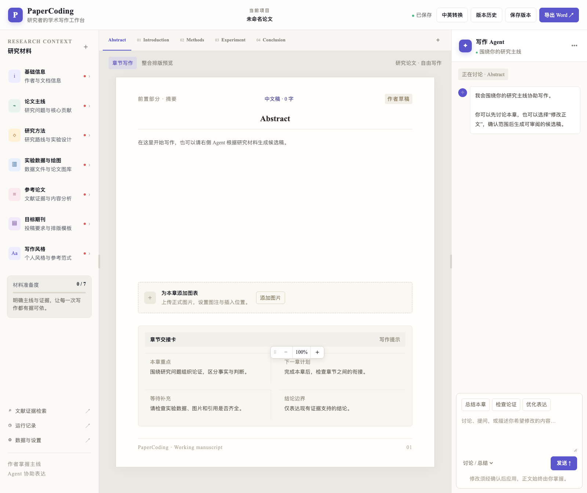

<p align="center">
  
</p>

<p align="center"><strong>把研究材料、论文编辑与 Agent 审阅放进同一个工作台。</strong><br />本地运行 · 证据辅助 · 作者确认</p>

<p align="center">
  <a href="#界面预览">界面预览</a> ·
  <a href="#核心能力">核心能力</a> ·
  <a href="#快速开始">快速开始</a> ·
  <a href="paperwriting/README.md">完整使用指南</a> ·
  <a href="paperwriting/docs/architecture.md">架构说明</a>
</p>

**PaperCoding** 面向希望结合自己的研究材料进行论文写作的研究者：在左侧整理材料，在中间编辑章节，在右侧与写作 Agent 讨论并审阅候选稿。

章节修改经过 Writer、Evidence Reviewer 与 Coordinator 协作；候选内容先供作者检查，确认后才应用到正文。论文、材料、版本与任务记录保存在本机，生成模型由使用者自行配置。

## 界面预览



*仓库附带的空白工作台截图。首次启动没有预装论文、文献、期刊模板或模型权重。*

## 核心能力

| 工作环节 | 已提供的能力 |
| --- | --- |
| **整理研究材料** | 管理研究主线、方法、PDF 文献、表格、图片与自己的 DOCX 模板。 |
| **编辑论文** | 分章节写作、自动保存、版本快照、冲突检测与恢复。 |
| **检索文献证据** | 默认关键词检索；可选本地向量检索与 RRF 混合召回，并展示降级状态。 |
| **协作修改章节** | Writer 起草、Evidence Reviewer 审阅、Coordinator 协调，必要时返修一次。 |
| **审阅与确认** | 对照原文检查候选稿；确认时再次校验版本与授权范围，并备份旧稿。 |
| **导出研究成果** | 导出 Markdown；上传 DOCX 模板后导出 Word，复杂版式需自行复核。 |

## 章节修改如何工作


协调后最多进行一次返修与复审。作者可以放弃候选稿；如果正文或研究材料已经变化，过期候选不会直接覆盖新内容。章节修改通过 LangGraph 保存检查点，支持中断后恢复。

三个角色默认使用同一个已配置模型，由不同提示词分工。上图对应**章节修改**；全文生成、翻译等任务使用各自的流程。

## 快速开始

需要 **Python 3.11+**，无需 Node.js 或前端构建。

### macOS / Linux

```bash
git clone https://github.com/SL9-rich/paperwriting.git
cd paperwriting/paperwriting
python3 -m venv .venv
source .venv/bin/activate
python -m pip install -r requirements.txt
python run.py
```

<details>
<summary>Windows PowerShell</summary>

```powershell
git clone https://github.com/SL9-rich/paperwriting.git
cd paperwriting/paperwriting
py -3.11 -m venv .venv
.\.venv\Scripts\python.exe -m pip install -r requirements.txt
.\.venv\Scripts\python.exe run.py
```

`py -3.11` 也可替换为已安装的更新 Python 版本。

</details>

打开 **[http://127.0.0.1:8501](http://127.0.0.1:8501)**。端口被占用时，macOS / Linux 在已激活的环境中运行 `python run.py --port 8502`；Windows 运行 `.\.venv\Scripts\python.exe run.py --port 8502`。

仓库名为 `paperwriting`，应用代码也位于其中的 `paperwriting/` 子目录，因此上面的两层路径是有意保留的。未配置模型时，可以先体验编辑、保存、材料管理和 Markdown 导出。

### 连接自己的生成模型

在应用目录中，将 [`.env.example`](paperwriting/.env.example) 复制为 `.env`，填写配置并重启：

```dotenv
LLM_BASE_URL=
LLM_MODEL=
LLM_API_KEY=
```

服务需支持 Chat Completions 格式与 JSON 对象输出。API 地址、模型与鉴权要求由所选服务决定；使用云端模型时，完成任务所需的论文和材料文本会发送给该服务。

语义检索为可选功能，默认关闭，不会自动下载权重。启用方法见 [模型与运行配置](paperwriting/docs/configuration.md)。

## 技术与目录

**Python · Starlette · LangGraph · SQLite · HTML / CSS / JavaScript**  
可选语义检索：**FastEmbed · NumPy · RRF**

```text
paperwriting/                    # 仓库根目录
├── README.md                    # GitHub 项目首页
└── paperwriting/                # 应用目录
    ├── run.py                   # 启动入口
    ├── frontend/                # 三栏网页工作台
    ├── papercoding/             # 业务、编排、存储、检索与 API
    ├── tests/                   # 合成数据与 mock 测试
    └── docs/                    # 配置、架构、数据与发布说明
```

## 使用边界与项目状态

- 面向**单人本机使用**，没有账号体系或多用户隔离，不适合直接部署为公网服务。
- 不附带生成模型、API 额度、真实论文或期刊模板；引用、数字和结论仍需作者核查。
- 仅章节修改支持检查点恢复；检索没有 OCR 或 DOI 真伪核验能力。
- 中英转换页的段落模板存在渲染问题，相关界面仍待修复。
- 仓库提供自动化测试代码，目前没有提交 GitHub Actions 配置。测试方法见 [完整指南](paperwriting/README.md#测试)，真实模型写作效果需另行评估。
- 项目级许可证尚待选择，来源与许可状态见 [NOTICE](paperwriting/NOTICE.md)。

## 文档导航

| 文档 | 内容 |
| --- | --- |
| [完整使用指南](paperwriting/README.md) | 安装、模型连接、可选检索与测试命令 |
| [模型与运行配置](paperwriting/docs/configuration.md) | API 合约、向量模型、数据路径与常见问题 |
| [架构说明](paperwriting/docs/architecture.md) | 模块职责、审批流程、检查点与检索实现 |
| [数据与安全边界](paperwriting/docs/security.md) | 本地数据、模型请求与部署范围 |
| [发布清单](paperwriting/docs/releasing.md) | 源码发布前的检查事项 |
