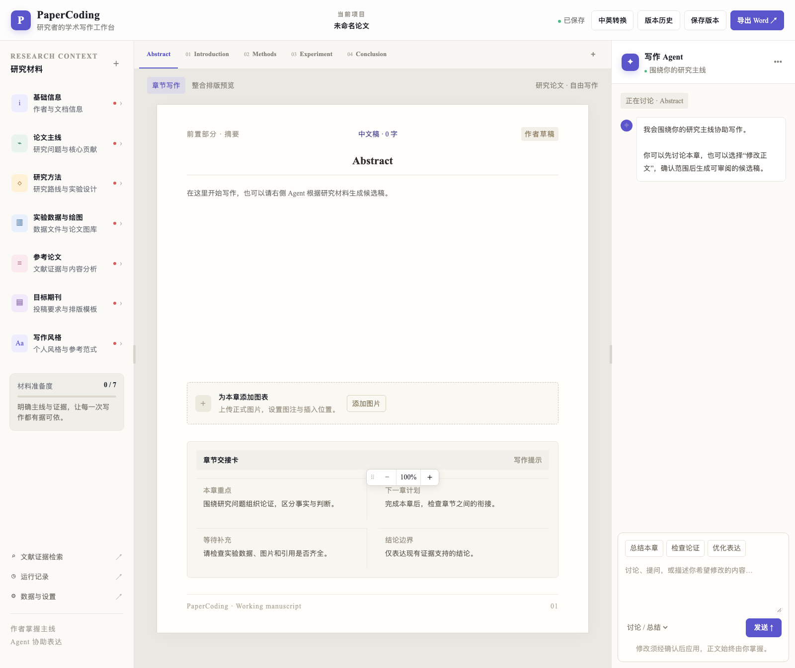
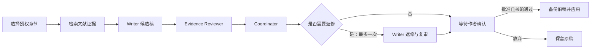

# PaperCoding

**一个本地运行、由研究者掌握最终修改权的 AI 学术写作工作台。**

PaperCoding 将论文编辑、研究材料管理、文献检索和多 Agent 审阅放在同一个网页工作台中。模型生成候选稿，作者检查后再应用；章节修改通过 LangGraph 保存检查点，支持中断恢复。

> **这是空白的源码发布版。** 不含论文、文献、期刊模板、私人数据、API 密钥或模型权重。首次启动仅有空白章节。使用者自行添加材料、配置生成模型 API，并按需启用本地向量模型。



## 核心能力

- **论文工作台**：章节编辑、自动保存、版本快照、冲突检测与恢复。
- **材料管理**：上传自己的 PDF 文献、DOCX 模板、表格和图片。
- **Agent 审阅**：Writer → Evidence Reviewer → Coordinator，必要时进行一次返修。
- **人工审批**：章节修改和全文生成均先生成候选，不直接覆盖正文。
- **可恢复执行**：章节修改保存 LangGraph 检查点和模型调用回执。
- **证据检索**：关键词检索；可选本地向量、RRF 混合召回及失败降级。
- **翻译与导出**：逐段中英翻译、确认、润色，以及 Markdown / DOCX 导出。

## 快速开始

需要 **Python 3.11+**。无需 Node.js 或前端构建。以下命令在仓库根目录执行。

```bash
python3 -m venv .venv
source .venv/bin/activate
python -m pip install -r requirements.txt
python run.py
```

Windows PowerShell：

```powershell
py -3 -m venv .venv
.\.venv\Scripts\python.exe -m pip install -r requirements.txt
.\.venv\Scripts\python.exe run.py
```

打开 **http://127.0.0.1:8501**。端口被占用时：`python run.py --port 8502`。

首次运行自动创建本项目的 `data/`，不读取其他项目的数据。未配置模型时仍可编辑、保存、管理材料和导出 Markdown；DOCX 导出需要先上传自己的 DOCX 模板。

## 配置自己的模型

### 1. 生成模型 API

复制 `.env.example` 为 `.env`，填写自己的配置，然后重启程序：

```dotenv
LLM_BASE_URL=
LLM_MODEL=
LLM_API_KEY=
```

| 配置 | 填写说明 |
| --- | --- |
| `LLM_BASE_URL` | 服务的基础地址，不含 `/chat/completions`；服务需要 `/v1` 时保留 `/v1` |
| `LLM_MODEL` | 该服务实际支持的模型标识 |
| `LLM_API_KEY` | 服务要求的密钥；不要求鉴权的本机服务可留空 |

程序发送 `POST {LLM_BASE_URL}/chat/completions`，使用 `messages`、`max_tokens` 和 `response_format: {"type":"json_object"}`。返回值须包含 `choices[0].message.content`，且正文可解析为 JSON 对象。**不是任意模型 API 都能直接使用**；接口不符合时，需要修改 `papercoding/infrastructure/llm.py` 适配。

可以接入云端服务，也可以接入自己部署的本机服务。本项目不部署生成模型、不训练模型，也不提供额度。只有本机 `localhost` / `127.0.0.1` / `::1` 允许 HTTP，其他地址要求 HTTPS。

**云端 API 会收到完成任务所需的论文和文献文本。** 使用前确认你可以把这些材料交给所选服务。密钥只在服务端读取，不返回到浏览器。

### 2. 可选：本地向量模型

默认 `PAPERCODING_ENABLE_EMBEDDINGS=false`，不会自动下载权重。纯关键词检索不需要向量模型；请求混合检索时会明确提示降级。

若需要语义检索，在激活的虚拟环境中执行：

```bash
python -m pip install -r requirements-embeddings.txt
```

并修改 `.env`：

```dotenv
PAPERCODING_ENABLE_EMBEDDINGS=true
PAPERCODING_EMBEDDING_MODEL=sentence-transformers/paraphrase-multilingual-MiniLM-L12-v2
```

重启后，添加文献并检索，或在界面点击“重建向量索引”。首次使用可能联网下载权重，默认缓存于 `.cache/embeddings/`；文献编码在本机执行。模型需受当前 FastEmbed 版本支持，下载可用性取决于网络及模型来源。

也可运行 `python -m papercoding.infrastructure.retrieval` 为自己的文献建立索引。详见 [模型与运行配置](docs/configuration.md)。

## 工作流程



Writer、Reviewer、Coordinator 默认使用同一个已配置模型，通过独立提示词分工。多 Agent 不等于多模型，也不保证必然提高写作质量。

## 代码结构

```text
.
├── run.py                     # 唯一启动入口
├── frontend/                  # 网页界面：HTML / CSS / JavaScript
├── papercoding/
│   ├── config.py              # 配置、数据目录、模型开关
│   ├── domain/                # 空白论文状态、共享规则与工具
│   ├── application/           # 写作用例、后台任务与 Agent 编排
│   ├── infrastructure/        # SQLite、模型 API、检索与导出适配
│   └── presentation/          # HTTP 路由与应用组装
├── tests/                     # 合成数据 / mock 测试，不附真实文献
├── docs/                      # 架构、配置、安全和发布说明
├── .github/workflows/         # 自动测试
├── .env.example               # 空白配置模板
└── requirements*.txt           # 核心 / 可选向量 / 开发依赖
```

运行生成的 `data/`、`.cache/`、本地 `.env` 与备份均不属于源码。各模块职责和依赖见 [架构说明](docs/architecture.md)。

## 测试

```bash
python -m pip install -r requirements-dev.txt
python -m pytest -q
python -m ruff check .
```

覆盖空白启动、模型配置、检索降级、版本冲突、人工审批、非法章节和无效引用、进程中断恢复、调用回执、Token 预算、并发锁、上传与导出等行为。测试使用临时目录、合成材料与 mock 响应，不请求真实模型，也不下载向量权重。

整理时在全新的 Python 3.12 环境中完成了 54 项测试。`constraints-py312.txt` 记录该环境的版本，可用 `pip install -r requirements-dev.txt -c constraints-py312.txt` 复用；它不是所有平台通用的锁文件。CI 配置覆盖 Python 3.11 / 3.12，远程运行结果以上传后的 Actions 为准。

当前公开版**不附带私人语料上的评测结论**，自动化测试不等同于真实模型质量或完整安全性证明。仓库没有预装演示论文；测试中的短文本仅是程序测试夹具。

## 当前边界

- 面向单人本机使用，没有登录和多用户数据隔离。**不要直接暴露到公网。**
- 仅章节修改支持检查点恢复；翻译等普通后台任务中断后需要重试。
- 每次章节修改最多 24 次逻辑模型调用，Token 预算为 80,000；网络重试和服务计费使它不等同于精确费用上限。
- 关键词召回不是 BM25；向量索引为 SQLite + NumPy 精确扫描，不是 ANN 检索服务。
- 无 OCR、DOI 真伪核验；语义相似或引用编号有效不代表内容真实。
- DOCX 依赖使用者提供模板，复杂版式需自行复核；不提供原生 PDF / LaTeX 编译。
- 内置审批和范围校验不能保证阻止所有提示注入，也不能代替作者审阅。

更多见 [安全与数据说明](docs/security.md)。

## 发布说明

这是从本地工作台整理出的独立 Python 发布版，移除了旧前端构建、Streamlit 备用界面、迁移代码、私人评测语料和运行数据。原项目不受影响。

上传前检查 [发布清单](docs/releasing.md)。项目级许可证待作者选择，第三方依赖保留各自许可；见 [NOTICE](NOTICE.md)。
